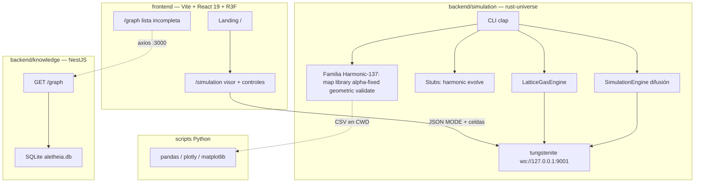
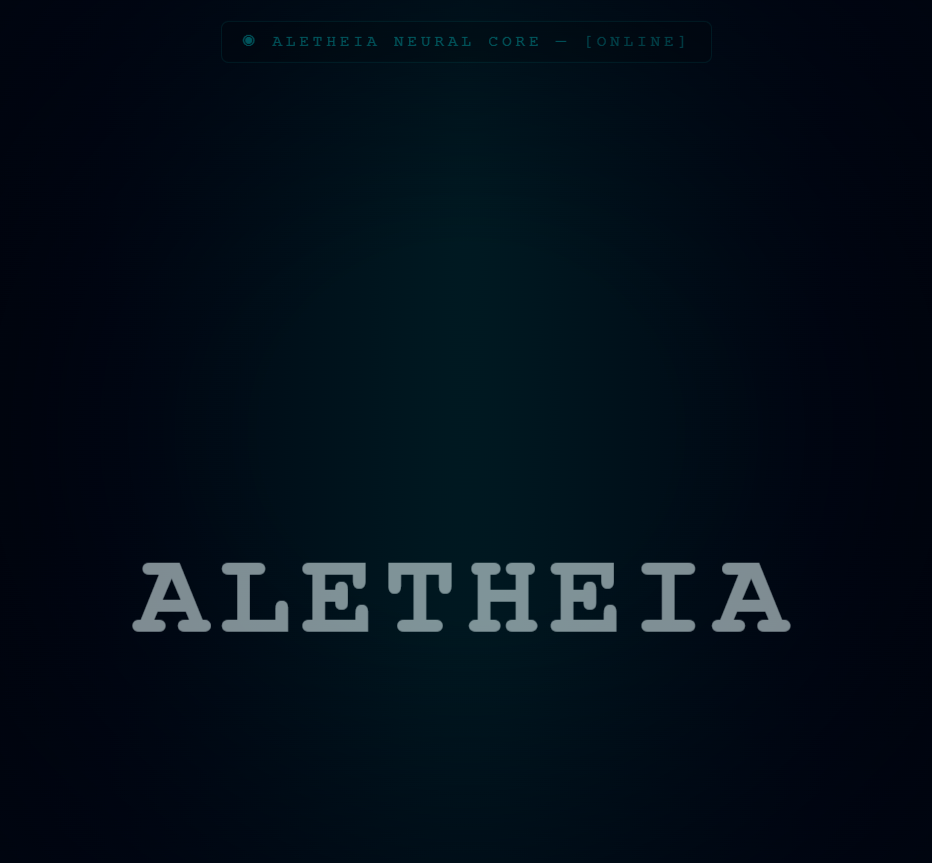
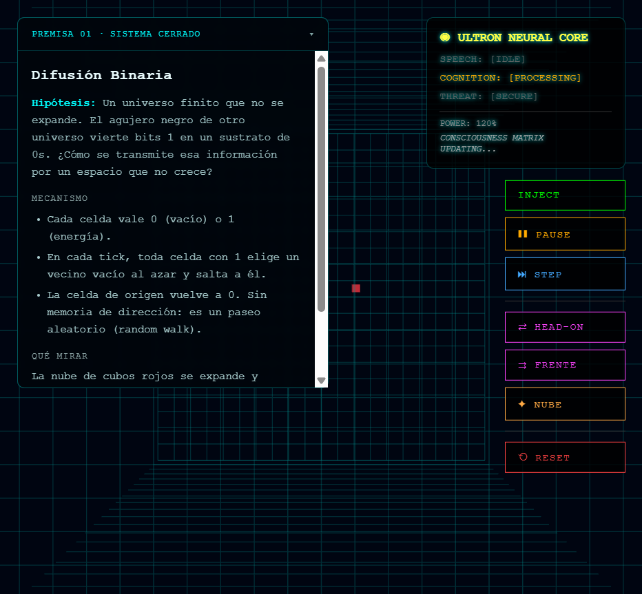
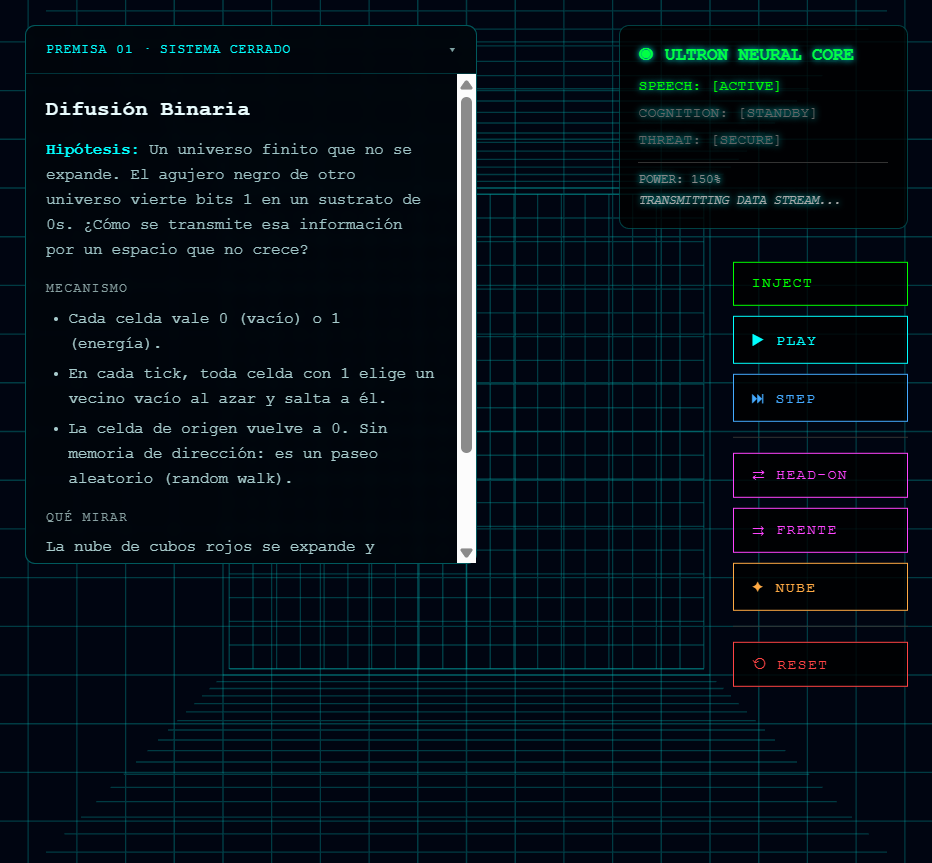
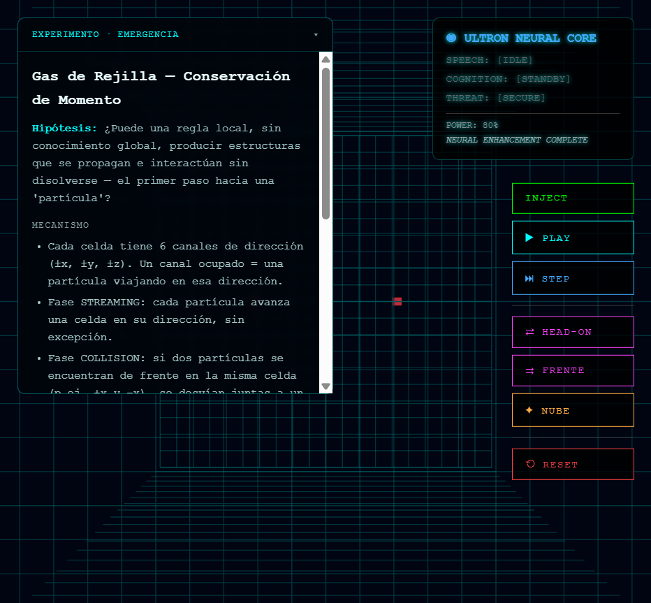
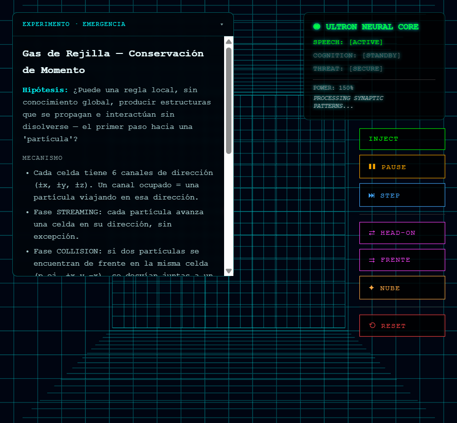

# Aletheia Engine

[English](README.md) · **Español**

Laboratorio experimental de **computación científica**, **exploración de hipótesis cosmológicas** y **simulaciones interactivas**.

No es un motor de producción ni una teoría física validada. Es un monorepo personal donde un CLI en Rust recorre espacios de constantes, un autómata 3D se visualiza en el navegador, y un API NestJS guarda un grafo de conocimiento de ejemplo.

> Harmonic-137 y las narrativas sobre α ≈ 1/137, bibliotecas de universos o selección cósmica son **hipótesis de trabajo**. Un `fitness` alto o un test interno en verde no demuestran que esas hipótesis sean ciertas.

**Documentación adicional (español):** [modelos y ecuaciones](docs/models.md) · [CLI y Python](docs/cli.md) · [resumen teórico](docs/THEORY_SUMMARY.md)

---

## 1. Identidad y evolución

### Qué es hoy

Tres piezas, tres runtimes:

| Pieza | Stack | Papel |
|---|---|---|
| `backend/simulation` | Rust 2021, crate `rust-universe` | CLI científico + dos motores 3D + WebSocket |
| `frontend` | Vite 6, React 19, React Three Fiber, Three.js | Landing, visor, controles |
| `backend/knowledge` | NestJS 11, TypeORM, better-sqlite3 | Grafo Node/Connection (desconectado del visor) |

### Cómo llegó hasta aquí

**Hecho (historial Git, 5 commits en `main`):** el repositorio nace como monorepo (sep 2025); un commit presenta «calibración / validation pass» del motor de constantes; luego «Aletheia upgrade» y **binary grid**; el HEAD local `1339fef` añade lattice gas, streaming y tests deterministas del grid.

**Hecho (código):** el CLI todavía se presenta como *«El Armónico 137 — The Cosmic Library»* (`main.rs`). Los modos `map`, `library`, `alpha-fixed`, `geometric` y `validate` existen. `harmonic` y `evolve` son stubs. La landing (trabajo local) cuenta el paso Harmonic-137 → Aletheia.

**Inferido, no demostrado por Git:** que existiera un flujo cotidiano «Rust genera CSV → Python/Plotly». Los scripts Python están en el árbol, pero los nombres de fichero **no coinciden** con el CLI actual ([cli.md](docs/cli.md)).

Línea intelectual que el código y la UI **afirman**, no que el laboratorio **haya confirmado**:

1. Explorar universos por el denominador de α.
2. Preguntar si reglas locales en un campo de bits pueden parecer «partículas».
3. Visualizar eso en tiempo real.

---

## 2. Inventario de capacidades

Estados: **verificado** (ALE-01B / ALE-02A) · **implementado sin verificar** (hay código; no se ejecutó en esas rondas) · **parcial** · **pendiente**.

### 2.1 Harmonic-137 — exploración numérica

Objetivo común: muestrear `CosmicLaw`, puntuar con `calculate_enhanced_fitness`, escribir CSV o logs. **No hay integración con el frontend.**

| Módulo | Objetivo | Implementación | I/O | Estado | Límites |
|---|---|---|---|---|---|
| `map` | Monte Carlo de universos | `sim_modes/map.rs` | `-u` universos → `landscape_data_enhanced.csv` | Implementado sin verificar | RNG no sembrado; default 10⁶ |
| `library` | «Libros» α = 1/N | `library.rs` | min/max α, samples → `cosmic_library.csv` + géneros literarios | Implementado sin verificar | Narrativa ≠ física |
| `alpha-fixed` | Fijar α, derivar `e` | `alpha_fixed.rs` | denominador, samples → `alpha_fixed_analysis.csv` | Implementado sin verificar | El print «¡CONFIRMADO!» no es un test |
| `geometric` | Curvatura / ratios 5D | `geometric.rs` | samples → `geometric_analysis.csv` | Parcial | Esos campos **no** entran en el fitness |
| `validate` | Comparar vs laboratorio | `validate.rs` | stdout | Parcial | Edad tautológica; masas pueden ser empíricas |
| `harmonic` | Búsqueda armónica | `harmonic.rs` | `--samples` | Pendiente | Un `println!` |
| `evolve` | Evolución de genomas | `evolve.rs` | `--seed`, `--generations` | Pendiente | Un `println!` |
| Scripts Python | Plots / «Adán» | `backend/simulation/scripts/` | CSV/JSON | Pendiente | CSV esperados ≠ los del CLI |

Detalle de flags: [docs/cli.md](docs/cli.md) (español).

### 2.2 Aletheia interactivo

| Módulo | Objetivo | Implementación | I/O | Estado | Límites |
|---|---|---|---|---|---|
| Difusión | Paseo aleatorio en cubo finito | `SimulationEngine`, comando `stream` | INJECT `state` ±1, ticks | Verificado | 51³ denso; sin aniquilación; UI inyecta solo `1` |
| Lattice gas | Masa/momento locales | `LatticeGasEngine`, comando `lattice` | INJECT / INJECT_DIRECTED | Verificado en un ensayo HEAD-ON | Sin tests unitarios; INJECT usa RNG de hilo |
| WebSocket | Un cliente, localhost | `stream.rs`, tungstenite | JSON MODE + `{tick, cells}` | Verificado | Puerto fijo 9001; un motor a la vez |
| Visor 3D | Pintar deltas | `SimulationViewer`, shaders quantum | cubos rojo/azul | Verificado | Cámara lejana; logs por celda |
| Controles | INJECT, PLAY/PAUSE, STEP, RESET, HEAD-ON, FRENTE, NUBE | `AletheiaAvatar` | mismos comandos JSON | Verificado (stream + HEAD-ON lattice) | FRENTE/NUBE no se ensayaron en ALE-01B |
| Landing | Narrativa y CTA | `LandingPage.tsx` | `/` → `/simulation` | Verificado (ALE-02A: scroll) | Premisa 02 deshabilitada |
| Fichas | Texto según `mode_id` | `content/experiments.ts` | MODE WS | Verificado | Poincaré en el texto lattice es interpretación, no un test |

### 2.3 Otros

| Módulo | Objetivo | Implementación | I/O | Estado | Límites |
|---|---|---|---|---|---|
| API Nest | Grafo de conceptos | `GET /`, `GET /graph` | SQLite `aletheia.db` | Implementado sin verificar (runtime) | `synchronize: true`; seed Plutón |
| Visualizador `/graph` | Mostrar el grafo | `GraphVisualizerPage` | axios `:3000/graph` | Parcial | Fetch sí; **no renderiza nodos** |
| HUD Ultron | «Core neural» | `useAletheiaState` | — | Cosmética | Timers aleatorios |
| Intro landscape | Efecto «cambio de canal» | `IntroductionPage` + `deprecated/` | — | Parcial | Fuera del router; excluido de `tsc` de la app activa |
| Nest nativo | `better-sqlite3` | install | — | Fallo observado en Node 24 | ClangCL / sin prebuild |

---

## 3. Fundamentos (vista corta)

Tres capas, tres grados de rigor:

| Capa | Qué hace el código | Tipo |
|---|---|---|
| α = e²/(4πε₀ħc), constantes CODATA/PDG en el universo de referencia | Definiciones y datos de entrada | Física establecida (como *insumo*) |
| Running α_s a 1 lazo, Jeans, Chandrasekhar, Gamow reducidos | Fórmulas recortadas + números fijos | Aproximación educativa |
| Fitness 0–1, géneros de «biblioteca», niveles 0–5 | Ordenar muestras | Heurística |
| Reproducción de universos, 137 «mágico», ternario conservativo, Premisa 02 | Texto y stubs | Hipótesis / pendiente |

El grid 3D **no** resuelve Einstein ni QCD. El lattice gas es una regla HPP mínima (6 direcciones, una colisión). El random walk **no conserva momento**.

Ecuaciones, pesos del fitness y trampas del fallback empírico: **[docs/models.md](docs/models.md)** (español).

---

## 4. Arquitectura

Flujos **integrados** (líneas sólidas): visor ↔ Rust por WebSocket.\
Procesos **independientes** (discontinua): CLI CSV, Python, Nest.



Tecnologías comprobadas en manifiestos: Rust, NestJS, React, Three.js, WebSockets. El visor no llama a Nest; Nest no llama a Rust; Python no arranca el grid.

---

## 5. Instalación y uso

### Requisitos

- Node.js 20+ (probado: **24.12.0**)
- pnpm 9 (probado: **9.12.0**)
- Rustc/Cargo (probado: **1.95.0**, edition 2021)
- Navegador con WebGL
- Python 3 + pandas/plotly/matplotlib **solo** para scripts (no usados en ALE-01B)

### 5.1 Laboratorio 3D — **ruta verificada**

```bash
# terminal 1
cd backend/simulation
cargo test --bin rust-universe
cargo run --bin rust-universe -- stream

# terminal 2 (raíz del monorepo)
pnpm install --ignore-scripts
pnpm --filter frontend dev
```

Abrir `http://127.0.0.1:5173/` → Premisa 01. Controles: INJECT, STEP, PLAY, PAUSE, RESET.

**Lattice** (mismo puerto; no simultáneo):

```bash
# detener stream, luego:
cargo run --bin rust-universe -- lattice
```

Recargar `/simulation`. Usar **HEAD-ON** (no solo INJECT).

Verificado también en ALE-02A tras corregir el scroll del layout.

### 5.2 Exploración numérica — **no ejecutada en ALE-01B**

```bash
cd backend/simulation
cargo run --bin rust-universe -- validate
cargo run --bin rust-universe -- alpha-fixed --alpha-denominator 137 --samples 100
```

Flags y CSV: [docs/cli.md](docs/cli.md). Generan ficheros en el CWD. No activar `--features empirical_validation` si se quiere el modelo teórico.

### 5.3 Python — **no viable tal cual**

Los scripts esperan CSV/JSON que el CLI actual no produce con esos nombres. Hasta alinearlos, no hay pipeline verificado.

### 5.4 API NestJS — **limitaciones**

```bash
cd backend/knowledge
pnpm start:dev
```

El script raíz `pnpm dev:backend:knowledge` filtra `backend_knowledge`, pero el paquete se llama `"backend"` y no tiene script `dev`.

`pnpm install --frozen-lockfile` **puede fallar en Node 24** al compilar `better-sqlite3` (sin prebuild; MSBuild pide ClangCL). **No está resuelto.** Para el 3D basta `--ignore-scripts`.

---

## 6. Evidencias ALE-01B

Ejecución en copia aislada (no se afirma que GitHub `origin/main` coincida con esta UI). Capturas reales:

| Qué | Resultado | Captura |
|---|---|---|
| Tests Rust | 8/8 | — |
| Landing | Carga |  |
| `stream` + PLAY | Cubo rojo, 1 celda activa |  |
| RESET stream | Grid vacío |  |
| Lattice HEAD-ON | Dos inyecciones dirigidas |  |
| Lattice PLAY | Motor vivo; a t=100/200 `masa=2`, `momento=(0,0,0)` en **ese** ensayo |  |
| Lattice RESET | Celdas apagadas |  |

**No verificado científicamente:** fitness, `validate`, QCD, BBN, conservación lattice en todos los ticks, scripts Python, Nest en caliente.

`pnpm --filter frontend build` (`tsc -b && vite build`) comprueba **la aplicación activa** (`main.tsx` → `AppRouter`: `/`, `/simulation`, `/graph`). El árbol `src/components/deprecated/`, `IntroductionPage.tsx`, `App.tsx` (no es el entry) y `src/lib/three/` (rayos; solo los usa `deprecated`) **siguen en el repo** y se excluyen de `frontend/tsconfig.app.json`. `SimplexNoise.d.ts` no es un fichero de declaraciones: es un cuerpo de clase (empieza en `constructor`), y TypeScript lo incluye porque el glob `src/**/*.ts` cubre `.d.ts`. `skipLibCheck` no lo omite: no es una librería de `node_modules`.

---

## 7. Para tres lecturas

**Arquitectura.** Monorepo pnpm + crate Rust. Trait `SimEngine` comparte el socket entre dos reglas. El frontend solo pinta deltas. Separación clara; el acoplamiento feo es el puerto 9001 hardcodeado.

**Física computacional.** Hay constantes reales y fórmulas reconocibles, envueltas en un fitness de juguete y en autómatas. El valor está en **dejar explícito qué es cada cosa** ([models.md](docs/models.md)), no en vender un universo emergente.

**Reclutador.** El código demuestra Rust (CLI, tests de semilla, WS), TypeScript/React/WebGL, y honestidad de alcance. Lo más débil para un portfolio público: artefactos todavía rastreados en Git (`target/`, `node_modules`, `.db`) hasta que se limpie el índice.

Tres capacidades que el repositorio **sí** muestra:

1. Servidor de simulación en Rust con dos motores y protocolo JSON.
2. Cliente 3D (R3F + GLSL) controlado en tiempo real.
3. Escáner de parámetros tipado (`CosmicLaw`) — como software, no como paper.

---

## Estado del árbol

Prototipo. Código muerto en `frontend/src/components/deprecated/` y Lygia vendorizada en `frontend/src/lygia/`. Sin `LICENSE` de raíz (Nest: `UNLICENSED`).
