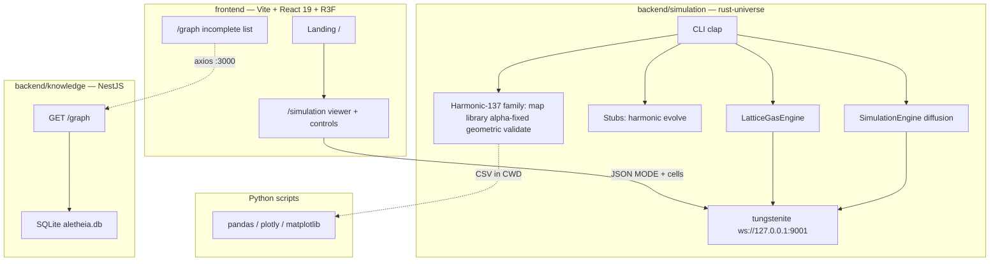
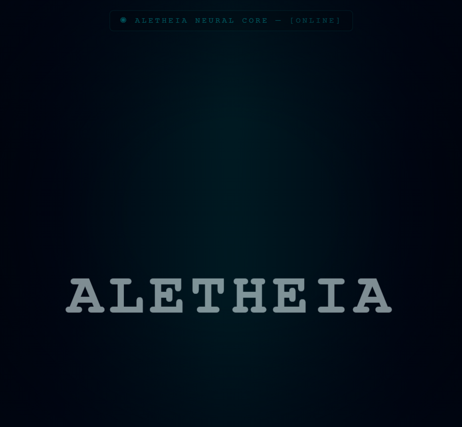
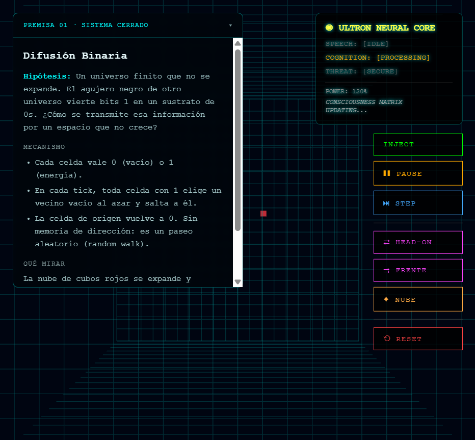
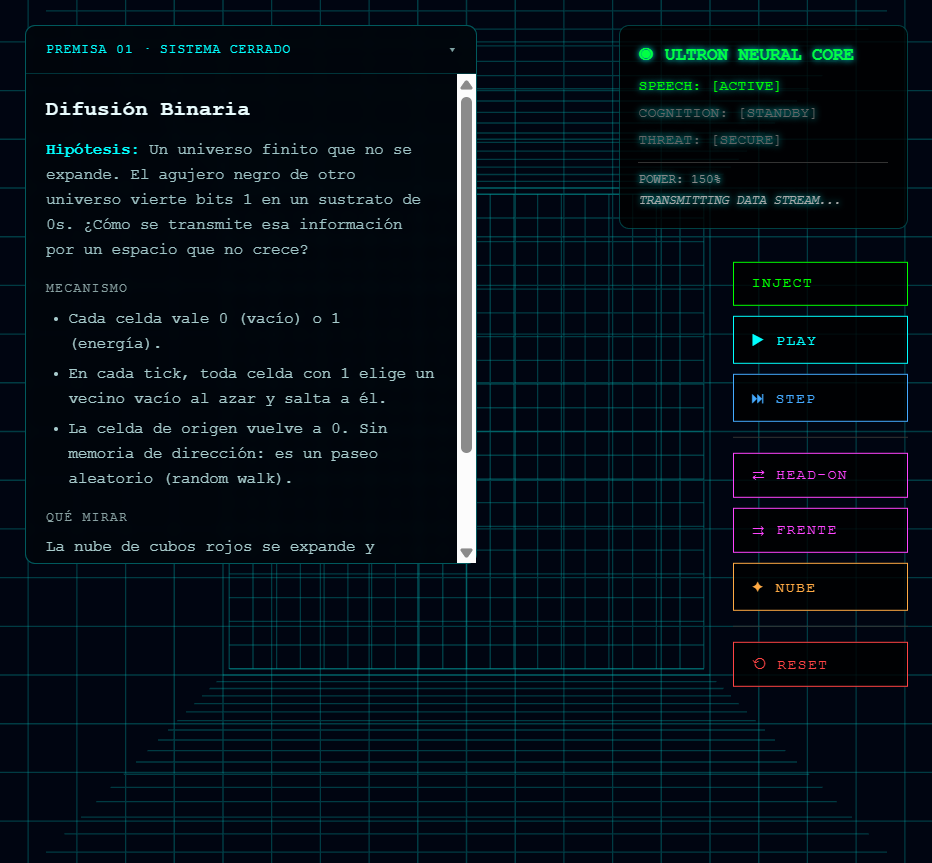
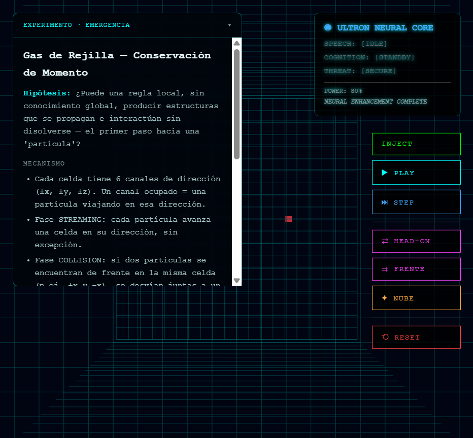
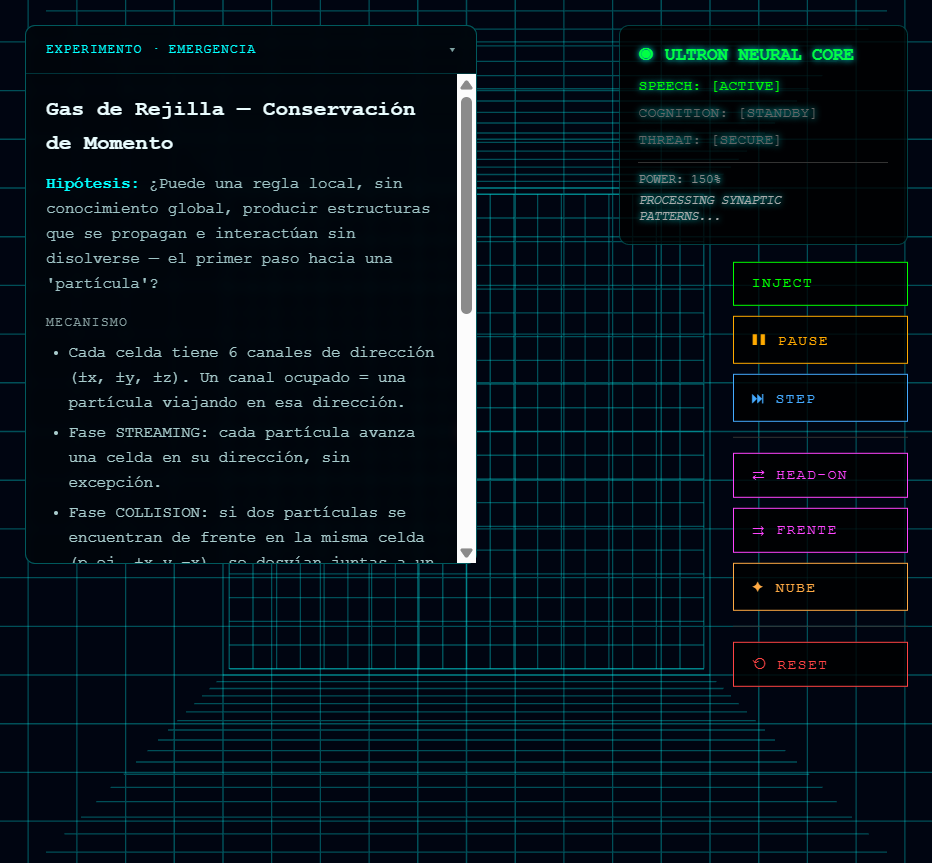

# Aletheia Engine

**English** · [Español](README.es.md)

Experimental lab for **scientific computing**, **cosmological-hypothesis exploration**, and **interactive simulations**.

This is not a production engine and not a validated physical theory. It is a personal monorepo: a Rust CLI samples constant-space, a 3D automaton is drawn in the browser, and a NestJS API stores a sample knowledge graph.

> Harmonic-137 and the stories around α ≈ 1/137, libraries of universes, or cosmic selection are **working hypotheses**. A high `fitness` score or a green internal test does **not** prove those hypotheses.

**Further docs (Spanish):** [roadmap](docs/ROADMAP.md) · [decisions](docs/DECISIONS.md) · [research log](docs/RESEARCH_LOG.md) · [models and equations](docs/models.md) · [CLI and Python](docs/cli.md) · [theory summary](docs/THEORY_SUMMARY.md)

---

## 1. Identity and history

### What it is today

Three pieces, three runtimes:

| Piece | Stack | Role |
|---|---|---|
| `backend/simulation` | Rust 2021, crate `rust-universe` | Scientific CLI + two 3D engines + WebSocket |
| `frontend` | Vite 6, React 19, React Three Fiber, Three.js | Landing, viewer, controls |
| `backend/knowledge` | NestJS 11, TypeORM, better-sqlite3 | Node/Connection graph (not wired to the viewer) |

### How it got here

**Historical (early Git on `main`):** the repo starts as a monorepo (Sep 2025); one commit presents a “calibration / validation pass” of the constants engine; then “Aletheia upgrade” and a **binary grid**; lattice gas, streaming, and grid tests follow. That era ended at `origin/main` = `d58c16e` (3D FluidCore). The “5 commits / HEAD `1339fef`” snapshot below is **stale as a description of current `main`**.

**Current local `main` (baseline `e550654` and later docs):** Harmonic-137 work is on this branch and **has not been pushed**. `--rng-seed` makes Monte Carlo replayable; `map --observables-csv` exports `EngineEvaluation`; Python loaders match CLI CSV names ([cli.md](docs/cli.md), [analysis.md](docs/analysis.md)). HAR-04B/C, HAR-VIS-01, HAR-EXP-01/02 are done. Status: [docs/ROADMAP.md](docs/ROADMAP.md).

**Fact (code):** the CLI still introduces itself as *“El Armónico 137 — The Cosmic Library”* (`main.rs`). Modes `map`, `library`, `alpha-fixed`, `geometric`, and `validate` exist. `harmonic` and `evolve` are stubs. The landing page narrates the Harmonic-137 → Aletheia step.

Intellectual line that the code and UI **claim**, not that the lab **has confirmed**:

1. Explore universes by the denominator of α.
2. Ask whether local bit-field rules can look like “particles”.
3. Visualize that in real time.

---

## 2. Capability inventory

Statuses: **verified** (ALE-01B / ALE-02A for 3D) · **regression-tested** (Harmonic CLI/CSV; software tests, not lab physics) · **partial** · **pending** (stub).

### 2.1 Harmonic-137 — numerical exploration

Shared goal: sample `CosmicLaw`, score with `calculate_enhanced_fitness`, write CSV or logs. **Not integrated with the frontend.**

| Module | Goal | Implementation | I/O | Status | Limits |
|---|---|---|---|---|---|
| `map` | Monte Carlo of universes | `sim_modes/map.rs` | `-u`, `--rng-seed`, optional `--observables-csv` → historical CSV + 30-col evaluation CSV | Regression-tested | Default 10⁶; column `alpha` = 1/α; loop `0..=N` |
| `library` | “Books” α = 1/N | `library.rs` | min/max α, `--rng-seed` → `cosmic_library.csv` | Regression-tested | Engine still recomputes SI α; narrative ≠ physics |
| `alpha-fixed` | Fix α, derive `e` | `alpha_fixed.rs` | denominator, `--rng-seed` → `alpha_fixed_analysis.csv` | Regression-tested | Variants of c/ħ/ε₀ do not enter the engine; “¡CONFIRMADO!” is not a test |
| `geometric` | Curvature / 5D ratios | `geometric.rs` | `--rng-seed` → `geometric_analysis.csv` | Partial | Those fields **do not** enter the fitness |
| `validate` | Compare vs lab | `validate.rs` | stdout | Partial | Tautological age; atomic level fails; masses may be empirical |
| `harmonic` | Harmonic search | `harmonic.rs` | `--samples` | Pending (stub) | A `println!` |
| `evolve` | Genome evolution | `evolve.rs` | `--seed`, `--generations` | Pending (stub) | A `println!`; `--seed` is a genome path, not RNG |
| Python scripts | Plots / “Adán” | `backend/simulation/scripts/` | CSV/JSON | Regression-tested | Names match CLI; venv outside Git; figures are not lab QCD |

Flag detail: [docs/cli.md](docs/cli.md) (Spanish).

### 2.2 Interactive Aletheia

| Module | Goal | Implementation | I/O | Status | Limits |
|---|---|---|---|---|---|
| Diffusion | Random walk in a finite cube | `SimulationEngine`, `stream` | INJECT `state` ±1, ticks | Verified | Dense 51³; no annihilation; UI injects only `1` |
| Lattice gas | Local mass/momentum | `LatticeGasEngine`, `lattice` | INJECT / INJECT_DIRECTED | Verified on one HEAD-ON trial | No unit tests; INJECT uses thread RNG |
| WebSocket | One client, localhost | `stream.rs`, tungstenite | JSON MODE + `{tick, cells}` | Verified | Fixed port 9001; one engine at a time |
| 3D viewer | Paint deltas | `SimulationViewer`, quantum shaders | red/blue cubes | Verified | Distant camera; per-cell logs |
| Controls | INJECT, PLAY/PAUSE, STEP, RESET, HEAD-ON, FRENTE, NUBE | `AletheiaAvatar` | same JSON commands | Verified (stream + HEAD-ON lattice) | FRENTE/NUBE were not exercised in ALE-01B |
| Landing | Narrative and CTA | `LandingPage.tsx` | `/` → `/simulation` | Verified (ALE-02A: scroll) | Premise 02 disabled |
| Copy cards | Text by `mode_id` | `content/experiments.ts` | MODE WS | Verified | Poincaré in lattice copy is interpretation, not a test |

### 2.3 Other

| Module | Goal | Implementation | I/O | Status | Limits |
|---|---|---|---|---|---|
| Nest API | Concept graph | `GET /`, `GET /graph` | SQLite `aletheia.db` | Implemented, runtime not verified | `synchronize: true`; Pluto seed |
| `/graph` visualizer | Show the graph | `GraphVisualizerPage` | axios `:3000/graph` | Partial | Fetch yes; **does not render nodes** |
| Ultron HUD | “Neural core” | `useAletheiaState` | — | Cosmetic | Random timers |
| Intro landscape | “Channel change” effect | `IntroductionPage` + `deprecated/` | — | Partial | Off the router; excluded from active-app `tsc` |
| Native Nest | `better-sqlite3` | install | — | Failure observed on Node 24 | ClangCL / no prebuild |

---

## 3. Foundations (short view)

Three layers, three degrees of rigor:

| Layer | What the code does | Type |
|---|---|---|
| α = e²/(4πε₀ħc), CODATA/PDG constants in the reference universe | Definitions and inputs | Established physics (as *input*) |
| 1-loop running α_s, Jeans, Chandrasekhar, reduced Gamow | Truncated formulas + fixed numbers | Educational approximation |
| Fitness 0–1, “library” genres, levels 0–5 | Rank samples | Heuristic |
| Universe reproduction, “magic” 137, conservative ternary, Premise 02 | Text and stubs | Hypothesis / pending |

The 3D grid **does not** solve Einstein or QCD. The lattice gas is a minimal HPP rule (6 directions, one collision). The random walk **does not conserve momentum**.

Equations, fitness weights, and empirical-fallback traps: **[docs/models.md](docs/models.md)** (Spanish).

---

## 4. Architecture

**Integrated** flows (solid lines): viewer ↔ Rust over WebSocket.\
**Independent** processes (dashed): CLI CSV, Python, Nest.



Stacks confirmed in manifests: Rust, NestJS, React, Three.js, WebSockets. The viewer does not call Nest; Nest does not call Rust; Python does not start the grid.

---

## 5. Install and use

### Requirements

- Node.js 20+ (tried: **24.12.0**)
- pnpm 9 (tried: **9.12.0**)
- Rustc/Cargo (tried: **1.95.0**, edition 2021)
- Browser with WebGL
- Python 3 + pandas/plotly/matplotlib **only** for scripts (not used in ALE-01B)

### 5.1 3D lab — **verified path**

```bash
# terminal 1
cd backend/simulation
cargo test --bin rust-universe
cargo run --bin rust-universe -- stream

# terminal 2 (monorepo root)
pnpm install --ignore-scripts
pnpm --filter frontend dev
```

Open `http://127.0.0.1:5173/` → Premise 01. Controls: INJECT, STEP, PLAY, PAUSE, RESET.

**Lattice** (same port; not simultaneous):

```bash
# stop stream, then:
cargo run --bin rust-universe -- lattice
```

Reload `/simulation`. Use **HEAD-ON** (not INJECT alone).

Also verified in ALE-02A after the layout scroll fix.

### 5.2 Numerical exploration — **not run in ALE-01B**

```bash
cd backend/simulation
cargo run --bin rust-universe -- validate
cargo run --bin rust-universe -- alpha-fixed --alpha-denominator 137 --samples 100
```

Flags and CSV: [docs/cli.md](docs/cli.md). Files land in the CWD. Do not enable `--features empirical_validation` if you want the theoretical model.

### 5.3 Python — **not viable as-is**

The scripts expect CSV/JSON names the current CLI does not write. Until those are aligned, there is no verified pipeline.

### 5.4 NestJS API — **limitations**

```bash
cd backend/knowledge
pnpm start:dev
```

The root script `pnpm dev:backend:knowledge` filters `backend_knowledge`, but the package is named `"backend"` and has no `dev` script.

`pnpm install --frozen-lockfile` **can fail on Node 24** compiling `better-sqlite3` (no prebuild; MSBuild wants ClangCL). **Unresolved.** For the 3D path, `--ignore-scripts` is enough.

---

## 6. ALE-01B evidence

Run in an isolated copy (this does not claim GitHub `origin/main` matches this UI). Real screenshots:

| What | Result | Capture |
|---|---|---|
| Rust tests | 8/8 | — |
| Landing | Loads |  |
| `stream` + PLAY | Red cube, 1 active cell |  |
| RESET stream | Empty grid |  |
| Lattice HEAD-ON | Two directed injections |  |
| Lattice PLAY | Live engine; at t=100/200 `mass=2`, `momentum=(0,0,0)` in **that** trial |  |
| Lattice RESET | Cells off |  |

**Not scientifically verified:** fitness, `validate`, QCD, BBN, lattice conservation on every tick, Python scripts, Nest at runtime.

`pnpm --filter frontend build` (`tsc -b && vite build`) typechecks the **active app** (`main.tsx` → `AppRouter`: `/`, `/simulation`, `/graph`). `src/components/deprecated/`, `IntroductionPage.tsx`, `App.tsx` (not the Vite entry), and `src/lib/three/` (lightning; only used from `deprecated`) **remain in the tree** and are listed in `frontend/tsconfig.app.json` `exclude`. `SimplexNoise.d.ts` is not a declaration file: it is a class body (starts at `constructor`). TypeScript still picks it up because `src/**/*.ts` includes `.d.ts`. `skipLibCheck` does not skip it: it is not a `node_modules` library.

---

## 7. Three readers

**Architecture.** pnpm monorepo + Rust crate. Trait `SimEngine` shares the socket between two rules. The frontend only paints deltas. Clean split; the ugly coupling is hardcoded port 9001.

**Computational physics.** Real constants and recognizable formulas, wrapped in a toy fitness and automata. The value is **saying what each piece is** ([models.md](docs/models.md)), not selling an emergent universe.

**Hiring.** The code shows Rust (CLI, seeded tests, WS), TypeScript/React/WebGL, and honest scope. Weakest for a public portfolio: artifacts still tracked in Git (`target/`, `node_modules`, `.db`) until the index is cleaned.

Three capabilities the repository **does** show:

1. A Rust simulation server with two engines and a JSON protocol.
2. A 3D client (R3F + GLSL) driven in real time.
3. A typed parameter scanner (`CosmicLaw`) — as software, not as a paper.

---

## Tree status

Prototype. Dead code in `frontend/src/components/deprecated/` and vendored Lygia in `frontend/src/lygia/`. No root `LICENSE` (Nest: `UNLICENSED`).
