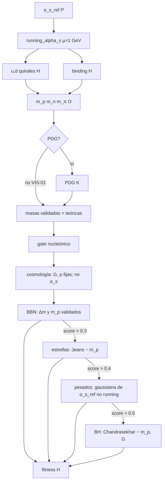

# HAR-MODEL-01 — Inventario y comparación pareada del modelo QCD

HAR-MODEL-01A: inventario y diseño (HEAD `df04aa1` / cierre `deff024`).
HAR-MODEL-01B/C: comparación A/B/D sobre VIS-01. **Cerrado** como comparación: A es el default; B/D experimentales; B no validada como QCD. PHYS-01 sigue aparte.

Línea base numérica: [HAR_EXP_01.md](HAR_EXP_01.md), [HAR_EXP_02.md](HAR_EXP_02.md). Una receta continua **no** es, por ese solo hecho, QCD de laboratorio.

---

## 1. Inventario del modelo vigente

Fuente: `backend/simulation/src/physics/engine.rs`, salvo donde se indica. Leyenda: **P** parámetro muestreado; **K** constante fija de implementación; **H** heurística; **O** observable calculado.

### 1.1 Acoplamiento fuerte de entrada

| Pieza | Qué es | Dónde |
|---|---|---|
| `CosmicLaw.alpha_s` | **P**, adimensional. Tratado como α_s(μ_ref), no como α_s(1 GeV) | `core/models.rs:8`; muestreo `map.rs:123` en `[0.05, 2.0)` |
| `AdvancedPhysicsEngine.alpha_s_reference` | Copia de `laws.alpha_s` | `engine.rs:28,40` |
| `reference_scale` | **K**, μ_ref = **91.1876 GeV** (masa del Z, no se deriva) | `engine.rs:29,41` |
| Referencia `validate` | α_s = 0.1181 «a la escala del Z» | `sim_modes/validate.rs:221` |

Unidades: α_s es un número puro. Las masas hadrónicas se convierten kg ↔ GeV con `C` y `GEV_TO_JOULE` (`engine.rs:11–15`).

### 1.2 Λ_QCD y n_f

| Pieza | Qué es | Dónde |
|---|---|---|
| `LAMBDA_QCD_GEV` | **K** = 0.217 GeV. **No** se calcula a partir de α_s_ref | `engine.rs:23` (duplicado en `constants.rs`, no usado por el motor) |
| n_f | **K** por tramos de μ: &lt;1.3 → 3; &lt;4.2 → 4; si no → 5 | `engine.rs:67` |
| β_0 | (11·3 − 2 n_f)/3 → **9** a μ=1 GeV | `engine.rs:68` |

A μ=1 GeV, n_f es siempre 3. Los saltos 1.3 / 4.2 GeV no afectan a las masas u/d/π actuales. `sim_modes/validate.rs:112–115` llama `running_alpha_s(2.0)` y `(91.2)` (n_f=4 y 5).

### 1.3 `running_alpha_s`

```text
si μ ≤ 1.5 Λ  (0.3255 GeV):  devolver α_s_ref
denom = 1 + (β_0 α_s_ref / 2π) ln(μ / μ_ref)
si denom > 0.1:  α_s_ref / denom
si no:           α_s_ref
```

`engine.rs:60–78`. No hay polo de Landau explícito: cuando denom ≤ 0.1 se **sustituye** el valor UV α_s(μ_ref), no un acoplamiento IR grande.

A μ=1 GeV, n_f=3: denom &gt; 0.1 ⇔ α_s_ref ≲ **0.1392266** (HAR-EXP-01). El corte μ ≤ 1.5Λ **no** se dispara a 1 GeV.

### 1.4 Masas quirales y binding

`constituent_quark_mass` (`engine.rs:80–112`), μ_had = **1 GeV**:

- u/d: masas quirales **K** 0.310 y 0.31125 GeV; `bare_mass_kg` **no entra** (salvo charm/`_`).
- Corrección **H**: 1 + 0.1 α_s_had (u/d); 0.05 / 0.02 / 0.01 otros.
- Asimetría u/d **K** `up_down_asymmetry = 0.5`.

`realistic_qcd_binding` (`engine.rs:117–126`): ignora `_hadron_type`.  
B = 2Λ (1 + 0.5(α_s_had − 0.3)) GeV, luego × `GEV_TO_JOULE`. **H**.

MIT bag (`engine.rs:128–181`) **no se llama** desde el fitness ni desde las masas teóricas.

### 1.5 Protón, neutrón, pion

`get_theoretical_hadron_masses` (`engine.rs:183–200`):

```text
m_p = 2u + d − B/c²
m_n = u + 2d − B/c²
m_π = u + d − B/c²
```

B es el mismo para p, n y π ⇒ **Δm = d − u**. Clamp **K**: `.max(0.0)`.

### 1.6 Fallback PDG y gates

| Pieza | Dónde | Notas |
|---|---|---|
| Masas empíricas | `engine.rs:18–21,114–116` | **K** PDG |
| `hadron_masses_need_pdg` | `engine.rs:537–538` | m_p≤0 ∨ m_n≤m_p ∨ m_p&gt;2e-26 ∨ m_n&gt;2e-26. NaN **no** entra (IEEE) |
| `get_validated_hadron_masses` | `engine.rs:202–214` | feature `empirical_validation` o predicado |
| `resolve_hadron_masses` | `engine.rs:398–414` | usado por `evaluate` |
| Gate nucleónico | `engine.rs:420–421,436` | sobre masas **validadas**: m_n&gt;m_p y m_n&gt;m_p+m_e |

HAR-VIS-01 / EXP-01: PDG = 0/401.

### 1.7 Heurística posterior

`evaluate` `engine.rs:417–522`. Pesos **K**: 0.15 / 0.25 / 0.25 / 0.20 / 0.15 + bonus 0.05. Tope `min(1.0)` (`486–487`).



| Etapa | ¿Usa running / masas teóricas? | Dónde |
|---|---|---|
| Cosmología | No (G, densidades fijas) | `217–232` |
| BBN | Sí: Δm y m_p **validados**; umbrales 1e-50 / 1e-47 | `258–276`, `237–256` |
| Estelar | Sí: Jeans ∝ m_p^(−1/2) implícito vía c_s; umbrales 1 Myr / 100 Gyr | `279–335` |
| Pesados | α_s_ref **sin** running (óptimo 0.118, σ=5 %); Coulomb EM; clamp `.min(1)` | `347–367` |
| BH | Chandrasekhar ∝ 1/(G^{3/2} m_p²); TOV = 2.5 M_Ch vs 25 M_☉ | `374–390` |

HAR-EXP-02 (universo de referencia, solo α_s): cosmología plana; stellar=0; heavy/BH no evaluados; salto en BBN y fitness al corte 0.1.

---

## 2. Auditoría de continuidad

No todo es el `if denom > 0.1`.

| Id | Tipo | Dónde | Efecto |
|---|---|---|---|
| D1 | Cambio de rama | `denom > 0.1` `73–77` | Salto de α_s(1 GeV) ~α_s/0.1 → α_s_ref. EXP-01/02 |
| D2 | Corte IR por μ | `μ ≤ 1.5Λ` `63–65` | Devuelve α_s_ref. Inactivo a 1 GeV |
| D3 | n_f por tramos | `67` | Salto de β_0 si μ cruza 1.3 o 4.2. Irrelevante a 1 GeV |
| D4 | Clamp masas | `.max(0)` `199` | Codo si B &gt; suma de quarks. No visto en EXP-02 (m_p mín. ~5.6e-28 kg) |
| D5 | PDG | `537–538` | Sustitución discontinua de m_p, m_n. 0/401 en VIS-01; sí a α_s=1e6 en tests |
| D6 | Gate nucleónico | `420–421` | Fitness 0 si falla; etapas posteriores `None` |
| D7 | Umbrales 0.1 / 0.3 / 0.4 / 0.5 / 0.6 / 0.8 | `440–478` | Abren o cierran etapas. EXP-02: BBN≤0.3 a α_s≳1.497 cambia **nivel**, no fitness (stellar ya 0) |
| D8 | Estelar 0 / 1 / cola | `326–334` | `stellar_score` no es C¹ |
| D9 | Pesados `.min(1)` | `366` | Saturación |
| D10 | Fitness `.min(1)` | `487` | Saturación; inactiva en EXP-02 |
| D11 | BBN 0/1 de secciones | `270–271` | Escalón si Gamow cruza 1e-50 / 1e-47 |
| D12 | denom → 0 | 1-loop | α_s_had → +∞ si no existiera D1. Régimen no perturbativo |
| D13 | denom &lt; 0 | α_s_ref grande | α_s_had negativo si se usara la fórmula sin D1. D1 evita el signo en el histórico |
| D14 | Unidades | kg↔GeV, GEV_TO_JOULE | Convención SI; no es una rama de código |

**Perturbativo no fiable:** α_s_had ≳ O(1), en particular justo bajo D1 (EXP-02: α_s(1 GeV)≈1.39). El 1-loop no es predicción cuantitativa ahí ([HARMONIC_VISION.md](HARMONIC_VISION.md) / D-14).

---

## 3. Alternativas candidatas

Ninguna se declara «física correcta» por ser continua. **A** es el control.

### A. Motor histórico (control)

Fórmula: §1.3. Parámetros libres: umbral 0.1, 1.5Λ, n_f, μ_ref, Λ (todos **K** hoy). Continuidad: **no** (D1). Positividad: α_s_had = α_s_ref &gt; 0 en el muestreo. Dominio: software actual. Comparación: identidad.

### B. Regularización continua del mismo 1-loop (especificación)

No es QCD. Es una mollificación **numérica** del `if denom > 0.1` de A, para que D1 deje de ser un salto. No se elige ε maximizando el fitness.

**Rechazado como B:** `α_s_ref / max(d, ε)`. Eso congela a α_s_ref/ε (acoplamiento grande si ε=0.1) y **no** reproduce la rama histórica `α_s_ref`. Sería otra familia, más cercana a C.

**Parámetros.** δ = 0.1, heredado de A (no es un grado de libertad extra). Único parámetro libre de B: **ε** ∈ (0, δ). n_f, β_0, μ_ref, Λ y el corte μ ≤ 1.5Λ son los de A (D2 no se suaviza aquí).

**Dominio.** El de A: μ &gt; 0, α_s_ref &gt; 0 (muestreo [0.05, 2)). Con 0 &lt; ε &lt; δ la banda de transición está en d &gt; 0, así que no se divide por cero.

Sean

```text
d(μ) = 1 + (β_0 α_s_ref / 2π) ln(μ / μ_ref)     # igual que A
δ    = 0.1
t    = (d − (δ − ε)) / (2ε)
s(t) = 0                     si t ≤ 0
     = 3t² − 2t³             si 0 < t < 1
     = 1                     si t ≥ 1
```

`s` es el *smoothstep* cúbico de Hermite (C¹; s'(0)=s'(1)=0).

```text
α_B(μ) =
  α_s_ref                         si μ ≤ 1.5 Λ          # D2, idéntico a A
  α_s_ref                         si d ≤ δ − ε
  α_s_ref / d                     si d ≥ δ + ε
  α_s_ref · [1 + s(t) (1/d − 1)]  si δ − ε < d < δ + ε
```

En la banda, α_B es combinación convexa de α_s_ref y α_s_ref/d.

**Continuidad.** En d, α_B es C¹: en d=δ−ε vale α_s_ref y la derivada es 0 (como la rama constante); en d=δ+ε vale α_s_ref/d y la derivada es −α_s_ref/d² (como el 1-loop). A μ fijo, d es afín en α_s_ref, así que α_B(α_s_ref) es C¹ salvo D2 y los saltos de n_f (D3), iguales que en A. Si ε→0⁺, B → A (la banda se contrae al salto D1).

**Positividad.** En la banda, d ∈ (δ−ε, δ+ε) ⊂ (0, ∞), α_s_ref &gt; 0, α_s_ref/d &gt; 0, y s ∈ (0,1) ⇒ α_B &gt; 0. Si d ≤ 0 (α_s_ref grande a 1 GeV), d &lt; δ−ε ⇒ α_B = α_s_ref &gt; 0, igual que A. D1 ya evitaba el 1-loop negativo; B conserva ese signo.

**Extremos (μ = 1 GeV, n_f = 3).** d ≈ 1 − 6.464 α_s_ref (HAR-EXP-01). α_s_ref → 0 ⇒ d → 1, α_B → α_s_ref. α_s_ref ≳ 0.155 ⇒ d ≲ 0 ⇒ α_B = α_s_ref. Polo de Landau d=0: está a la izquierda de δ−ε, se devuelve α_s_ref, no ∞. Justo bajo el corte histórico (α_s_ref ≲ 0.1392266) A alcanza α_s_had ≈ α_s_ref/0.1 ~ O(1); B también, fuera de la banda |d−0.1|&lt;ε.

**ε inicial.** No se ajusta al fitness ni a PDG. Debe ser: (i) &lt; δ para no incluir d≤0; (ii) grande frente a redondeo `f64`; (iii) pequeño frente a la variación de d en el muestreo, para localizar el cambio en el entorno del salto EXP-01/02. Δd = ε corresponde a Δα_s_ref ≈ ε/6.46 a 1 GeV. **Valor inicial documentado: ε = 0.02** (banda d ∈ [0.08, 0.12] ⇒ α_s_ref ≈ [0.136, 0.142] a 1 GeV). Es una elección de resolución numérica, no un dato de laboratorio.

**Sensibilidad de ε (predefinida, no optimizada):** {0.005, 0.02, 0.05}. Opcional 0.001 como control «casi A». Informe: cuantiles de |X_B(ε) − X_A| y fracción de `sample_id` con cambio de nivel. Si las tres ε dan el mismo ranking de fitness, eso no valida QCD: solo dice que el índice es estable bajo este mollificador.

**Limitación.** El 1-loop sigue siendo no perturbativo cuando α_had ~ O(1). B no repara D4–D14. Sin bibliografía QCD (recorte de software). Comparación: mismos `CosmicLaw`; solo cambia `running_alpha_s`.

### C. Congelación infrarroja (distinta del histórico)

El histórico **no** es una congelación IR canónica: al fallar denom devuelve α_s(**μ_ref**), el valor UV.

Una C honesta fijaría α_s(μ) = α_s_pert(μ_IR) para μ &lt; μ_IR, o α_s(μ²+m_IR²), de modo que el IR sea un acoplamiento **grande y finito**, no el de m_Z.

Parámetros: μ_IR o m_IR. Continuidad: según el empalme. Positividad: si α_s_pert(μ_IR) existe y es &gt;0 (exige denom(μ_IR)&gt;0). Dominio: fenomenología de α_s efectiva a bajo μ. Limitación: **hace falta bibliografía** si se adopta un esquema publicado (p. ej. reemplazo μ²→μ²+m² / freezing); aquí no se elige cita. Comparación: igual que B, aislando el running.

### D. Sin running hadrónico

α_s_had := α_s_ref en u/d/binding (equivalente a no llamar al 1-loop a 1 GeV). Cero parámetros extra. Continua en α_s_ref. Positiva. Dominio: modelo aún más crudo. Limitación: tira EXP-01 (desaparece la rama 1-loop). Justificación: control negativo «¿cuánto mueve el running *además* del corte?». Sin bibliografía.

---

## 4. Diseño de HAR-MODEL-01B (ejecutado)

Experimento mínimo de comparación, **condicionado** a esta fórmula de B. No es HAR-EXP-03 (eso exige `stellar_score > 0.4`). No sustituye el CLI.

| Pieza | Decisión |
|---|---|
| Variantes | **A** (control, `new()` histórico), **B** (ε=0.02 + barrido {0.005, 0.02, 0.05}), **D** (α_s_had = α_s_ref). **C aplazada** |
| Entrada | Misma población HAR-VIS-01: `map --universes 400 --rng-seed 137137`, `sample_id` = 0..=400. **No** nuevo muestreo por variante |
| Identidad | Un `CosmicLaw` por `sample_id`; A/B/D se evalúan sobre esa misma ley |
| CSV | Independientes por variante (y por ε en B), fuera de Git. No tocar `landscape_data_enhanced.csv` ni hashes VIS-01 |
| Gráficas | Plotly pareadas: (X_A − X_V) vs α_s_ref y overlay A/B/D de α_s(1 GeV), m_p, Δm, fitness; tooltip `sample_id` |
| Default | `RunningKind::Historical`; sin flag CLI; bitwise el `running_alpha_s` actual cuando el kind es A |

Métricas por `sample_id` (pareadas, no solo histogramas):

| Grupo | Campos | Tipo |
|---|---|---|
| Entrada | α_s_ref, g, e, α_si | emparejamiento |
| Running | denom, α_s(1 GeV), rama / ε | numérico |
| Masas | Δm_p, Δm_n, Δ(Δm), Δm_π teóricos | numérico |
| PDG / gates | XOR de fallback, nucleón, stellar/heavy/BH `None` vs valor | discreto |
| BBN | Δ nucleosynthesis_term | heurística |
| Fitness | Δ fitness, Δ nivel, Δ fitness_uncapped | heurística |
| vs α_s_ref | scatter de (X_A − X_V) | sensibilidad |

Informe: cuantiles de |ΔX|, fracción con cambio de nivel/gate, zoom α_s ∈ [0.12, 0.16]. Separar «el motor cambió» de «el universo es más habitable». Un `evaluate()` por variante y muestra; RNG solo para reproducir leyes.

---

## 5. Riesgos y arquitectura recomendada

Opciones:

1. **Duplicar `AdvancedPhysicsEngine`.** Costoso; dos fitness; fácil divergir.
2. **Plugins / trait pública.** Prematuro; empuja CLI y API.
3. **Campo interno `RunningKind` (recomendado).** `new()` deja `Historical` (bitwise el `running_alpha_s` actual). Variantes solo en constructor `pub(crate)` / test / runner de comparación. Un `match` en `running_alpha_s`. Sin flag CLI. Sin segundo muestreo. `evaluate()` único. Masas quirales y binding **no** se duplican.

**Aprobado e implementado en 01B:** opción 3. `new()` = Historical. `with_running_kind` es `pub(crate)`. Sin plugins ni flag CLI.

---

## 6. Recomendación técnica

1. **A** único comportamiento de `map` / CLI (`new()` = Historical).
2. Primera comparación: **B** (fórmula §3, ε=0.02 + sensibilidad predefinida) y **D**.
3. **C** aplazada hasta esquema + cita.
4. HAR-MODEL-01B = código mínimo de variantes internas + corrida pareada VIS-01 + Plotly. **No** es HAR-EXP-03.
5. HAR-PHYS-01 decide si alguna variante **sustituye** al histórico. Hasta entonces, A no se toca.

---

## 7. Decisiones aprobadas (HAR-MODEL-01A)

| Id | Decisión |
|---|---|
| A | Motor histórico: control inmutable; `new()` y CLI no cambian |
| B | Regularización continua §3: primera candidata experimental |
| D | α_s_had = α_s_ref: control negativo |
| C | Congelación IR fenomenológica: **aplazada** (hace falta bibliografía si se adopta un esquema publicado) |
| Arquitectura | Campo interno `RunningKind`; sin plugins; sin flag CLI |
| Comparación | Pareada, mismos universos / semilla / `sample_id`; sin nuevo muestreo por variante |
| ε | Inicial 0.02; sensibilidad {0.005, 0.02, 0.05}; **no** optimizar con el fitness |

HAR-MODEL-01B implementa A/B/D. **A permanece el default** (`new()`, CLI). B y D son variantes experimentales internas. B **no** está físicamente validada. HAR-MODEL-01 (comparación) **cerrado**; HAR-PHYS-01 sigue aparte.

---

## 8. Resultados HAR-MODEL-01B

Población: 401 `CosmicLaw` de `map --universes 400 --rng-seed 137137`, un sorteo, cinco evaluaciones. CSV y HTML **fuera de Git**: `C:\Users\igomez\Desktop\labs\labs\Aletheia-Engine-har-model01b-runs\`.

Hashes históricos (idénticos a HAR-VIS-01 / EXP-01):

| Archivo | SHA-256 |
|---|---|
| `landscape_data_enhanced.csv` (map A) | `FC966CE1…649F9268` |
| `engine_evaluations.csv` histórico | `2D19E32D…2CD0C715` |

El CSV `variant_A_historical.csv` replica las columnas de evaluación del map (mismos `sample_id` y mismos observables); el schema añade `variant`, `epsilon`, `running_denominator`, `running_alpha_s_1gev`.

En esta población, «fitness distinto» y «algún observable distinto» coinciden (el running a 1 GeV es el único conmutador).

| Comparación | n fitness ≠ A | n algún observable ≠ A | n nivel | n gate nucleón | n stellar 0↔1 | max \|Δfitness\| | ids |
|---|---:|---:|---:|---:|---:|---:|---|
| B ε=0.02 | 2 | 2 | 0 | 0 | 0 | 0.0228 | 234, 297 |
| B ε=0.005 | 1 | 1 | 0 | 0 | 0 | 0.0053 | banda más estrecha |
| B ε=0.05 | 5 | 5 | 0 | 0 | 0 | 0.0280 | 5/6 con \|α_s−0.13923\|<0.01 |
| D | 22 | 22 | 2 | 0 | 2 | 0.682 | las 22 *running* EXP-01; nivel 219 y 351 |

Medianas globales de \|ΔX\| = 0. B no es QCD. D no es un modelo superior: apaga el 1-loop.

### 8.1 Niveles 1→5 en `sample_id` 219 y 351 (variante D)

El motor admite **0..=5** (`evaluate`, `engine.rs:484–526`; `library.rs:103–110` nombra el 5). No hay nivel 6. Condiciones, sin cambiarlas:

| Nivel | Condición (sobre scores ya calculados) |
|---|---|
| 1 | `nucleosynthesis_score > 0.3` |
| 2 | `stellar_score > 0.4` |
| 3 | `heavy_elements_score > 0.5` |
| 4 | `black_hole_score > 0.6` |
| 5 | `black_hole_score > 0.8` **y** `heavy_elements_score > 0.7` (+ bonus 0.05) |

Correspondencia de muestras: mismo `sample_id`, mismos `g` y `α_s_ref` en A y D (emparejado por id, no por orden de CSV). PDG=0. Nucleón y cosmología iguales.

| id | A: α_s(1 GeV) | A stellar / heavy / BH / nivel / fitness | D: α_s(1 GeV) | D stellar / heavy / BH / nivel / fitness |
|---|---:|---|---:|---|
| 219 | 0.643 (running; denom 0.194) | **0.0** / None / None / **1** / 0.380 | 0.125 (=α_s_ref) | **1.0** / 1.0 / 1.0 / **5** / 1.0 (tope) |
| 351 | 0.997 (running; denom 0.134) | **0.0** / None / None / **1** / 0.318 | 0.134 (=α_s_ref) | **1.0** / 1.0 / 1.0 / **5** / 1.0 |
| 234, 297 | α_s_ref (cutoff A) | 0.0 / None / None / 1 | idéntico a A | idéntico a A |

`stellar_term = 0.0` en A **no** es un `None` mal exportado: BBN>0.3 abre la etapa; `stellar_formation_details` (`engine.rs:366–385`) devuelve 0 si la vida Jeans &lt; 1 Myr. Con el 1-loop, m_p es menor (p. ej. 351: 7.82e-28 kg vs 9.73e-28 kg en D) → c_s mayor → M_Jeans mayor → vida ∝ M^(−2.5) cae bajo el umbral. D usa α_s_ref, m_p sube, Jeans entra en [1 Myr, 100 Gyr], `stellar_score=1>0.4`, y entonces pesados (gaussiana de **α_s_ref**, no del running) y BH puntúan 1. El 1→5 es **legítimo** según las reglas vigentes. B (ε=0.02) no mueve 219/351: denom fuera de [0.08, 0.12].

Figuras Plotly (hover `sample_id`): `cmp_alphas_1gev.html`, `cmp_fitness_A_vs_B.html`, `cmp_delta_fitness.html`, `cmp_level_gates.html`, `cmp_epsilon_sensitivity.html`. No se tocaron figuras VIS-01 / EXP-01 / EXP-02.

Tests: C⁰ en los bordes de banda; C¹ analítica `dα_B/dd` más diferencias centrales en el interior. En los nudos, un FD unilateral es O(h) porque f'' es grande (`s~t²`); eso es estabilidad numérica, no un fallo de C¹.

---

## 9. Riesgos y cierre

- B suaviza D1; D4–D14 siguen. Δfitness ≠ cosmología.
- C aplazada (cita).
- **Decisión:** conservar A como único `new()` / CLI. B y D quedan como `RunningKind` interno.

---

## 10. Alcance HAR-MODEL-01

Cerrado como inventario + comparación pareada. PHYS-01 (¿sustituir el 1-loop?) sigue en cola. Sin EXP-03. Sin `evolve`.
